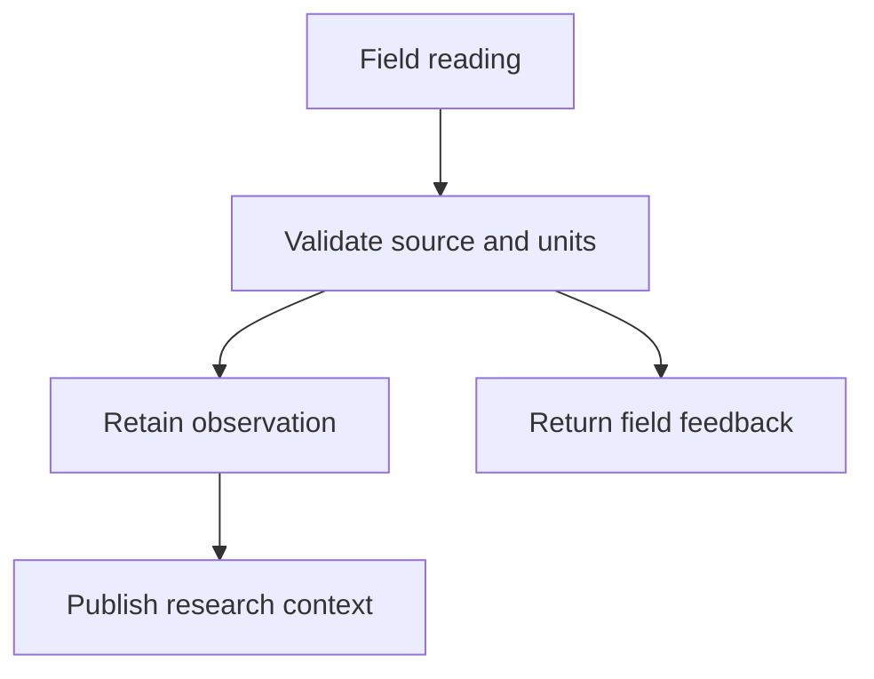

---
tags:
- demo/tour
demonstrates:
- diagrams
---

# Render and edit diagrams

## A Mermaid flow



Use **Edit diagram** to edit the source beside a live preview. Changes autosave in the originating Markdown. Try Fit, zoom, internal scrolling, Expand and Export SVG. Invalid syntax stays editable. A larger diagram is available in [[Reference/Architecture diagram]].

## A native drawing

![[Drawings/Station map.excalidraw|720x380]]

Open the drawing as its own tab, or choose **Edit inline** here. Drag a shape, add text, then choose Done. Pan/zoom alone does not change the drawing file. The drawing starts centered horizontally. Its toolbar offers SVG and PNG export.

## A Markdown drawing container

[[Drawings/Research sketch.excalidraw.md]] demonstrates a Markdown file containing a scene and retained prose. It opens in drawing mode. Both formats can be embedded. Create a fresh drawing or insert a Mermaid block from the command palette.

Open [[Tours/07 Attachments]] next.

## Drawings owned by this note

Use [[Tours/19 Inline drawings]] for actual `excalidraw` fences, `::: excalidraw`
containers and plain/compressed Drawing sections inside ordinary Markdown.

## A mind map for field day

This board uses Mindflow JSON and the bundled Mindflow canvas. Scroll over the canvas to zoom, drag the background to pan, and choose **Fit** to see the whole board. Select **Edit mind map**, drag Research and watch its children move, then double-click a node to rename it. Right-click for duplication, reparenting and branch colors. Select a node and press **Tab** to add a child. Click the dashed cross-link to select and style its connector. Choose **Save map** to update the note. Reading view uses the same interactive viewer; PDF export prints a static diagram.

```mindmap
{
  "nodes": [
    {
      "id": "root",
      "text": "Field day",
      "x": 650,
      "y": 360,
      "color": "#7a4cff"
    },
    {
      "id": "research",
      "text": "Research",
      "x": 410,
      "y": 280,
      "color": "#ff5c35",
      "parentId": "root"
    },
    {
      "id": "ridge",
      "text": "Walk the ridge trail",
      "x": 175,
      "y": 245,
      "color": "#ff5c35",
      "parentId": "research"
    },
    {
      "id": "readings",
      "text": "Compare sensor readings",
      "x": 175,
      "y": 325,
      "color": "#ff5c35",
      "parentId": "research"
    },
    {
      "id": "supplies",
      "text": "Supplies",
      "x": 890,
      "y": 270,
      "color": "#20b8e5",
      "parentId": "root"
    },
    {
      "id": "radio",
      "text": "Pack a backup radio",
      "x": 1125,
      "y": 270,
      "color": "#20b8e5",
      "parentId": "supplies"
    },
    {
      "id": "debrief",
      "text": "Debrief",
      "x": 890,
      "y": 455,
      "color": "#f43fa4",
      "parentId": "root"
    },
    {
      "id": "experiment",
      "text": "Choose the next experiment",
      "x": 1125,
      "y": 455,
      "color": "#f43fa4",
      "parentId": "debrief"
    }
  ],
  "edges": [
    {
      "id": "edge-research",
      "from": "root",
      "to": "research",
      "color": "#ff5c35",
      "shape": "curve",
      "dash": "solid"
    },
    {
      "id": "edge-ridge",
      "from": "research",
      "to": "ridge",
      "color": "#ff5c35",
      "shape": "curve",
      "dash": "solid"
    },
    {
      "id": "edge-readings",
      "from": "research",
      "to": "readings",
      "color": "#ff5c35",
      "shape": "curve",
      "dash": "solid"
    },
    {
      "id": "edge-supplies",
      "from": "root",
      "to": "supplies",
      "color": "#20b8e5",
      "shape": "curve",
      "dash": "solid"
    },
    {
      "id": "edge-radio",
      "from": "supplies",
      "to": "radio",
      "color": "#20b8e5",
      "shape": "curve",
      "dash": "solid"
    },
    {
      "id": "edge-debrief",
      "from": "root",
      "to": "debrief",
      "color": "#f43fa4",
      "shape": "curve",
      "dash": "solid"
    },
    {
      "id": "edge-experiment",
      "from": "debrief",
      "to": "experiment",
      "color": "#f43fa4",
      "shape": "curve",
      "dash": "solid"
    },
    {
      "id": "review-readings",
      "from": "readings",
      "to": "debrief",
      "color": "#7a4cff",
      "shape": "elbow",
      "dash": "dashed",
      "manual": true
    }
  ]
}
```

Use **Insert mind map** from the command palette to create another. In Source mode, paste a raw Mindflow board object (its `nodes` and `edges`) inside a `mindmap` fence. The same JSON can be copied back out after editing.

To import a downloaded board, open **Edit mind map → Import / repair JSON**, paste the full JSON, choose **Load board**, then **Save map**. This replaces only that map. The same panel opens automatically if a fence contains malformed JSON.

Thanks to Danny (@dimkinv) for the Mindflow canvas, the Excalidraw team for the drawing tools, and the Mermaid team for diagram rendering.
