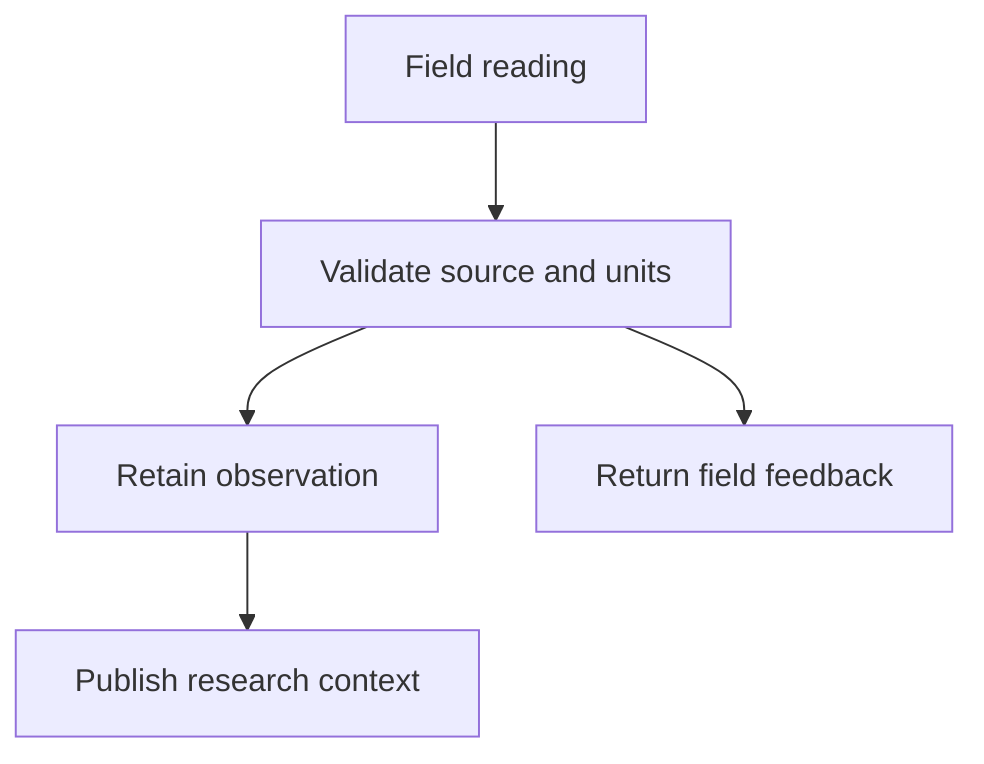

---
tags:
- demo/tour
demonstrates:
- diagrams
---

# Render and edit diagrams

## A Mermaid flow

Use **Edit diagram** to edit the source beside a live preview. Changes autosave in the originating Markdown. Try Fit, zoom, internal scrolling, Expand and Export SVG. Invalid syntax stays editable. A larger diagram is available in [[Reference/Architecture diagram]].

## A native drawing

![[Drawings/Station map.excalidraw|720x380]]

Open the drawing as its own tab, or choose **Edit inline** here. Drag a shape, add text, then choose Done. Pan/zoom alone does not change the drawing file. The drawing starts centered horizontally. Its toolbar offers SVG and PNG export.

## A Markdown drawing container

[[Drawings/Research sketch.excalidraw.md]] demonstrates a Markdown file containing a scene and retained prose. It opens in drawing mode. Both formats can be embedded. Create a fresh drawing or insert a Mermaid block from the command palette.

Open [[Tours/07 Attachments]] next.
