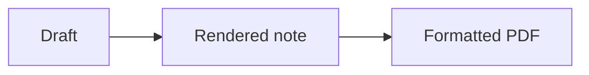

---
tags:
- demo/tour
demonstrates:
- pdf-export
---
# A document worth sharing

Open **Save as PDF…** from the command palette (Cmd/Ctrl+Shift+P), File menu, or a Markdown note’s context menu. The export uses your current draft without changing the Markdown file. Detached Markdown files have the same operation.

## Try the controls

1. Choose A4, portrait, default margins and 100% scale.
2. Enable **Include filename as title (H1)** to add the filename above this heading. Disable it to use only the heading written in this note.
3. Enable page numbers, choose a destination and inspect the PDF.
4. Try Letter, landscape, minimal margins and 80% scale for a wide document.
5. Switch Draglass to dark mode and export again: paper formatting remains light.

The most recently used export options are remembered for vault notes. The export dialog also offers Open PDF after saving. Canceling either dialog leaves the note unchanged. Only formatted body content is exported; YAML metadata and editor controls are omitted.

## Formatted content

| Content | Expected result |
| --- | --- |
| **Bold** and *italic* | Readable typesetting |
| [[Tours/13 Note links\|Note links]] | A readable note label |
| [External reference](https://example.com) | Clickable web link |
| Long table content that exceeds a narrow cell | Wrapped text rather than horizontal clipping |

- [ ] An open checklist item
- [x] A completed checklist item

> Notes, tables and diagrams are real content. Export should contain the whole document, not just the visible editor viewport.

```js
const exportOptions = { pageSize: 'A4', includeTitle: true };
```

## Diagrams and attachments



![[Drawings/Station map.excalidraw]]

![[Attachments/Station.svg|320]]

Embedded notes are rendered recursively with the normal depth guard. Diagrams render in light colors. Audio, video and embedded PDF viewers are represented by labeled media placeholders. Missing or failed embeds remain visible as notices. Internal links are readable labels; same-note heading/block links and external web links can remain navigable.

## Useful checks

Export a long practice note with several pages: table headers should repeat when a table crosses pages, headings should stay with following text, code should wrap, and images/diagrams should fit the page. Reopen the source afterward and verify that no title or page-layout syntax was inserted.
