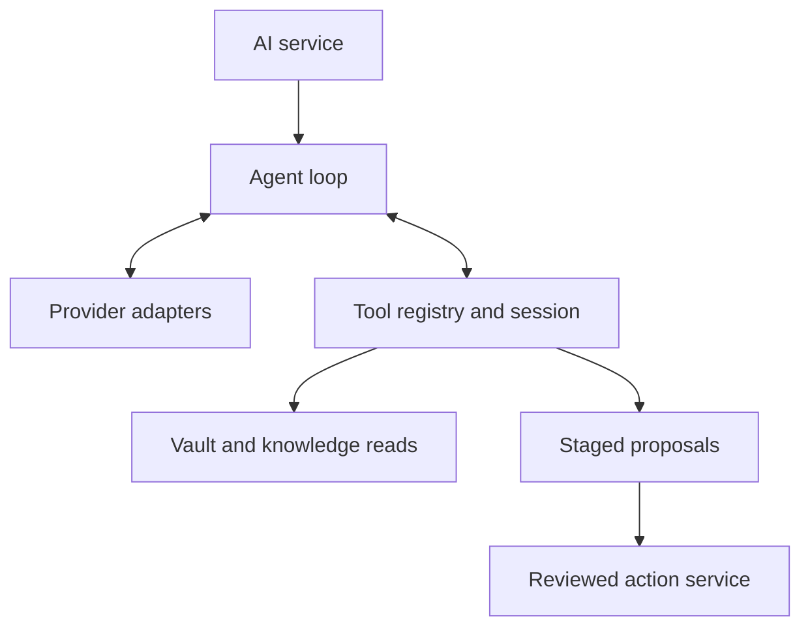

# Local application architecture

## Ownership and execution

| Layer | Owns | Execution |
| --- | --- | --- |
| Renderer (`ui/`) | Editor state, unsaved text, selections, DOM/canvas rendering, graph filtering and force animation | Sandboxed browser/UI thread; no Node filesystem or provider secrets |
| Preload (`electron/preload.cjs`) | Explicit operation bridge | Context-isolated Electron preload; no general-purpose execution endpoint |
| Desktop shell (`electron/main.cjs`) | Windows, dialogs, asset protocol, file-open routing, watcher notifications, IPC validation, mutation queue and AI service lifetime | Electron main process |
| Knowledge service (`core/backend/client.cjs`) | Requests, cancellation, worker lifetime, timeout, failure propagation and isolation by vault | Electron-independent Node client; uses `worker_threads` |
| Knowledge worker (`core/backend/worker.cjs`, `index.cjs`) | Incremental content index, search metadata, query execution, tags, backlinks, visual graph construction and bounded derived-view cache | One Node worker per active vault |
| Existing domain modules (`core/`) | Validated paths, Markdown/YAML semantics, ontology, links, safe writes, file organization, AI protocols and persistence | Reused by their owning service or renderer as appropriate |

`core/` identifies reusable code, not a process. Search and tag computation no longer run in the renderer. Graph construction now runs in the worker; rendering, filtering and force simulation still run in the renderer. The raw graph snapshot endpoint remains for embeds, AI entity drafting and evidence navigation. Those callers are follow-up opportunities, not migrated services.

## Query contract

`KnowledgeService(root)` supports `request(method, args, {signal})`, `latest(channel, method, args)` and `close()`. The service has no dependency on Electron. Methods are `scan`, `folders`, `resources`, `graph`, `search`, `tags`, `backlinks` and `graphModel`; unknown operations reject. Worker messages carry a request ID, operation and data; replies carry the same ID and either a result or an error message. Filesystem and mutation APIs are not exposed through this worker protocol.

Search receives query, sort and a sparse list of unsaved drafts. Each draft contains path, Markdown and the editor's saved version. Drafts are request-scoped overlays on existing indexed notes, never file writes or a second persisted vault. The saved version is context only; it does not authorize a write or suppress external refresh. Search and tag responses contain result metadata, not the entire vault. Limits: 64 drafts, 8 MiB-equivalent source character guard per draft plus a 32 MiB total byte limit; note files retain the existing 8 MiB disk limit.

The renderer uses independent generation counters for searches and tags and resets them on vault changes. A new search cancels the earlier client request on its channel. Cancellation rejects pending callers promptly and discards late replies; the worker skips queued cancelled requests when possible. Already-running synchronous computation, including regex evaluation, cannot be interrupted by a cancellation message. A 30-second request timeout bounds caller waiting but does not forcibly interrupt the worker. Stronger execution budgets and regex isolation remain future work.

## Index and consistency

`Vault.scan` serializes scans per instance and retains file text/content hashes when mtime, ctime, size and inode are unchanged. A scan walks directories and stats entries; it reads/hashes only added or changed note files. Deleted paths leave the cache after a successful scan. All new snapshots replace the old snapshot only after the traversal succeeds. Metadata-only changes also advance the knowledge revision. Derived graph caches are invalidated on index changes and bounded to four views. Parsed search properties/tags are reused while note text is unchanged, including request-scoped draft text.

This is an in-memory index, rebuilt after restart. Directory traversal/stat work is still proportional to vault size. Watchers notify the UI; periodic reconciliation remains a correctness fallback. It is not yet an event-maintained persistent index. Files changing during a traversal can cause a failed query; callers can retry or wait for the next reconciliation. No guarantee of a transactional snapshot across arbitrary external writers is claimed.

Knowledge reads bypass the desktop mutation queue, so an outstanding search does not hold up autosave. Note reads and writes retain the existing ordered bridge path. Safe writes use temporary files, atomic replacement and recovery snapshots. Renames, moves and AI action application remain reviewed domain operations on that path. A query concurrent with a mutation can reflect an earlier snapshot; watcher/reconciliation refreshes correct the view. The worker never writes user notes.

## Lifecycle, packaging and scope

A candidate vault is indexed before replacing the active service. Switching vaults terminates the old worker and rejects its pending requests; shutdown terminates the active worker. Idle workers are unreferenced so they do not keep the app alive. A worker failure rejects pending requests; the next request starts a fresh worker and rebuilds its index. No automatic retry replays a mutation. Worker code is included by the existing `core/**` application packaging rule.

Provider credentials, proxy configuration and AI orchestration remain in the existing Node main-process services. This slice adds no Rust, remote backend, HTTP listener, database or new dependency. A later slice can move AI orchestration, mutation planning and graph physics behind independent service interfaces. Native packaged Electron/ASAR worker behavior on macOS, Windows and Linux still requires target-platform verification.

## Workspace containers and views

`core/workspace-tree.cjs` owns a serializable tree. A split contains two containers, a direction and a resize ratio. A tab group contains view leaves and its selected view ID. Nesting creates rows within columns or columns within rows; closing a group collapses its redundant parent. Container and view IDs are independent of file paths.

Leaves are typed: note/drawing, graph, search, backlinks or outline. Note leaves carry file paths, reading state and bounded navigation history. Tool leaves carry bounded state and optional source-group bindings. Scroll and pin state belong to the leaf. A view references a canonical application buffer at runtime. The buffer holds file content, editor state, shared undo history, pending saves and disk version. Opening the same file in another group creates another view of that buffer; closing a view releases the buffer only when no other view needs it. Clean unused navigation buffers can be evicted and reread. File moves update view paths and navigation history.

`ui/workspace-view.js` renders the container tree and manages group focus, independent toolbars, tab membership, drag/drop, nested splits and resizing. `ui/app.js` coordinates document loading, autosave and service calls. Existing note services use an active-group adapter: canonical DOM identifiers follow focus, and the properties editor moves to the selected surface. This adapter is a compatibility boundary, not the persisted workspace model. It can be replaced service by service without changing the tree schema.

`ui/workspace-tools.js` owns a runtime registry keyed by leaf ID. Factories mount a scoped graph, search, backlinks or outline root; activation reuses an existing instance. A hidden graph stops its animation. Disposal disconnects resize observers, aborts document/window listeners, clears timers and invalidates asynchronous responses. Moving a view preserves its ID and runtime. Runtime objects and file bodies never enter the serialized tree.

Every graph instance owns its simulation, camera, controls and local/global settings. DOM lookups are root-scoped; inactive instances retain unique prefixed IDs, with active aliases for compatibility. Graph data requests use independent backend reads, avoiding cancellation between instances. Search uses a validated leaf-specific latest-request channel, separate from sidebar search. Each renderer also guards results by its view lifetime, vault epoch and query generation.

Linked views persist a source group ID plus the last resolved file path. A group remembers its last note leaf while showing a tool. Switching notes in the bound group updates local graph/backlinks/outline data; focusing unrelated groups does not. Removing a source group converts the binding to a fixed file. Missing files leave their tools usable. Outlines parse a single note's Markdown from the current buffer where available; search, backlinks and graph construction use the knowledge worker with unsaved draft overlays.

Stacked-tab presentation and layouts across detached windows remain follow-up extensions.

`WorkspaceStore` and `SavedWorkspaceStore` persist sanitized layout metadata, never buffers, note bodies, credentials or conversations. Saved layouts are vault scoped, atomically written and limited to 32. Tree normalization bounds containers, views, depth, path lengths, ratios and history; removes unknown fields; and makes IDs unique. Earlier flat and two-pane layouts are accepted as input and become trees when opened. Restoring flushes drafts, reads current files, skips unavailable targets and reconstitutes groups and selected views. Backend indexing and file mutation boundaries remain unchanged.

## Shared appearance

The app owns the theme preference and resolves system appearance into the root `data-theme`. The palette toggle changes that preference to the opposite resolved Light/Dark value. It uses the same appearance path as Settings and OS media-query updates. Theme selection is not stored in graph leaves.

Graph HTML uses app semantic CSS tokens. `ui/graph-theme.js` reads the resolved graph canvas tokens; the runtime registry invalidates each graph's color cache and schedules a repaint, including paused graphs. Hidden graphs read the current tokens when shown. This path does not rebuild simulations or reset view state. Diagram runtimes retain their existing shared appearance updates.

## Bounded vault AI · 0.23.0

`core/ai/vault-agent.cjs` orchestrates the model loop through the separate `core/ai/tools/` component. Normal chat starts with reference paths only; no note bodies or vault-wide title list are inserted automatically. Search and graph traversal use bounded `aiSearch`/`aiConnections` operations in the existing knowledge worker. Note reads and metadata use validated vault paths; explicit reference drafts remain request-scoped local overlays. Tool results are untrusted data. Discussion exposes read tools only; Propose changes adds create and line-range update tools that stage reviewed actions. Revisions, coverage of replaced lines, disk conflict checks, acceptance checks and undo protect unrelated or later edits. Per-request staging does not mutate notes.

`context-budget.cjs` limits every model request, including tool follow-ups and the existing entity-draft flow. A connection defaults to a 65,536-token window, configurable from 8,192 to 1,048,576. Output space (up to 4,096 chat / 8,192 tool-action tokens) and 1,024 safety tokens are reserved. A conservative charge of twice serialized UTF-8 input bytes plus 1,024 covers tokenizer differences and protocol/CLI wrapping, including tool definitions. This intentionally underuses many models’ practical capacity; it is not a claim of exact token counting for arbitrary vendor tokenizers. Users must set the actual model window or lower. Transport adapters independently reject inputs over the budget. No automatic increase occurs after provider errors.

Old large tool results are replaced by explicit retired-result records; older history becomes bounded conversation excerpts or is omitted with a progress notice. Complete assistant call/result groups are removed together; a large completed round can become a bounded result excerpt while staged note contents stay local. The current request and system rules remain intact; essential overflow fails before transport. Reads cap 60 lines and at most 4,000 UTF-8 bytes, reduced for small windows, with offsets for long lines. Other results cap 6,000 bytes and paginate. Each run caps 32 turns, 100 calls, 12 calls per turn and 12 proposed notes, with cancellation and a ten-minute overall timeout. Raw provider tool output is not streamed as a final answer. Verified citation ranges are retained in conversation history; only paths/ranges actually fetched become clickable in the sidebar. Native CLIs keep built-in tools disabled; JSON envelopes request Draglass tools through the same loop.

## Ontology and date discovery · 0.23.1

`inspect_ontology` is a read-only application tool available even without a vault. `core/ai/tools/ontology.cjs` reads classifications and descriptions from `core/plugins/ontology.cjs`, properties and example templates from `entity-templates.cjs`, and endpoint/subtype suggestions from that module’s relationship rules. There is no second AI schema catalog. Overview, entity, relationships and examples queries support offset pagination, at most six items and 4,800 serialized UTF-8 bytes per result. Entity pages label generated values as examples; they are not factual defaults. Inverse rules swap endpoints and subtype suggestions, while associated_with is explicitly symmetric. Custom predicates are permitted without an invented canonical meaning. Missing definitions produce correctable tool errors. No schema catalog is preloaded into the prompt.

`find_notes_by_date` uses `core/ai/tools/date.cjs` and the knowledge worker’s `aiDateSearch` operation. It searches filesystem created/modified milliseconds, a named YAML date property, or exactly one YYYY-MM-DD date in a basename. At least one bound is required; from/to are validated YYYY-MM-DD calendar dates and include both entire UTC days. Date-only properties use UTC midnight; ISO timestamps require an explicit timezone and normalize to UTC. Missing, malformed or ambiguous dates are excluded. Created timestamps follow Vault’s birthtime-or-mtime fallback; modified timestamps describe disk state, including when unsaved property overlays are supplied. Results are sorted by matching timestamp descending, then path, and return paginated paths/titles/dates, not bodies. The normal 6,000-byte tool-result and whole-request context guards still apply. Notes are read separately when requested.

## Current-time discovery · 0.23.2

`get_current_time` is a read-only tool available with or without a vault. `core/ai/tools/time.cjs` captures the device clock once per invocation, returning the same instant as UTC and an ISO local timestamp with offset, plus local date, weekday, resolved timezone, UTC offset in minutes and the system timezone. It defaults to the device timezone, with an optional IANA timezone or UTC override. Intl supplies timezone and daylight-saving rules; invalid zones produce correctable tool errors. No network time source, vault read, file write or cached clock result is used.

The short system instruction tells the model to call the clock fresh for current/relative dates each user turn. The date-query tool continues to use inclusive UTC days, so local and UTC dates are explicitly distinguished. Clock results and its compact schema count toward the existing whole-request budget. Tool guidance was shortened to preserve small-window headroom without changing those limits or access restrictions.

## Managed note timestamps · 0.23.3

Desktop mutation sessions enable manageTimestamps on Vault and DetachedDocument. Low-level storage instances and the read-only knowledge worker retain byte-preserving primitives. A shared `core/note-timestamps.cjs` policy patches only the two root YAML values, preserving unrelated formatting, comments, anchors, BOM, newline style and note body. Normal note creation, entity creation, accepted AI creation and Markdown imports set created_at/updated_at to the same current UTC ISO instant; successful content updates retain the saved creation value and refresh updated_at. Missing creation values use the known filesystem birthtime or modification-time fallback on first edit. Reads, watcher refreshes and identical saves never migrate notes. Native and Markdown drawing formats are excluded. Invalid frontmatter is saved unchanged with an actionable timestamp warning rather than blocking autosave or repairing user text.

Renderers merge returned managed fields into the latest editor state with a non-history transaction. Concurrent typing stays in place and remains dirty for its next save; metadata-only synchronization does not schedule another save. The properties pane shows full UTC values as managed read-only fields.

AI acceptance permits only timestamp-field differences when aligning a just-flushed draft with its stored proposal. All other content remains subject to stale-editor/disk checks. Prepared timestamped after/undo text is persisted before application and passed through conditional writes, so receipt recovery and guarded Undo compare the actual bytes written. Import and link-rewrite operations use the same managed mutation sessions. Recovery copies and trash restoration preserve their original snapshots.

## AI tool component · 0.23.4

Application tools are a separate component under `core/ai/tools/`. `index.cjs` owns the private catalog of schemas, capability requirements and handlers. Its public API is `toolDefinitions({hasVault, actionMode})` and `createToolSession(...)`. A session exposes `definitions()`, `execute(call)`, `result()` and `close()`. Native API and CLI adapters receive schemas/call results; they do not own application tool behavior. The model loop no longer imports Markdown parsers, vault queries, proposal validators or tool handlers.

| Owner | Responsibility |
| --- | --- |
| AI service | Provider selection, credentials, cancellation, conversation persistence and proposal receipts |
| Agent loop | Prompt policy, model turns, call IDs, turn/call limits and whole-request context budgeting |
| Tool registry | Enabled schemas, read/stage capabilities, argument validation and per-result size checks |
| Tool session | Request-local snapshots, draft overlays, read coverage, citations and staged proposals; cancellation/close checks around asynchronous reads |
| Tool handlers | Time, dates, ontology, vault reads and proposal staging using explicit read/query ports |
| Action service | User acceptance, conditional file writes, timestamp policy, receipts and Undo |

Global tools (time and ontology) work without a vault. Vault reads require a vault; proposal tools additionally require action mode. Selection is fixed when creating the session and cannot be changed by model arguments or mutated schema copies. Providers, messages, credentials, UI objects and write/create capabilities do not enter the handler context. The caller supplies only a bounded read-size allowance rather than passing model/provider configuration into the tools. Proposal validation is isolated in `core/ai/proposal.cjs`; the tool component does not import the action store.

Every run uses a fresh session, and the agent closes it in finally on success, failure or cancellation. Closing clears retained snapshots, drafts, coverage, citations and proposals. Late reads cannot return data into a cancelled/closed session. `result()` transfers a detached snapshot so callers cannot mutate retained proposals.

The knowledge worker imports result pagination and date-domain helpers directly from the tool component, without importing an agent or its conversation policy. Existing internal character-offset tool compatibility remains isolated in `tools/legacy-notes.cjs`; it is not registered in the active model catalog. Its compatibility loop retains its existing behavior.

This is an internal module boundary, not a separate process or third-party plugin API. Search/graph queries still use the knowledge worker, while tool dispatch and AI orchestration retain their current Node process ownership. Tool names, schemas, context budgets, read-only discussion and reviewed writes are preserved.

## Tasks core plugin · 0.24.0

`core/tasks/model.cjs` parses real Markdown task nodes and canonical Task notes. It resolves pure checkbox wikilinks to task notes and deduplicates references. `core/tasks/query.cjs` is a pure declarative query engine with date resolution, paging and explanations; no JavaScript evaluation is permitted. Both modules can be used without Electron.

The knowledge worker caches the task model alongside existing draft-aware knowledge views. Tasks panes, fenced results and AI queries share this engine. Task notes remain ordinary YAML/Markdown; the cache is derived and disposable. Reads are isolated from the ordered write queue.

`core/tasks/service.cjs` owns semantic create/update/promotion operations. It validates portable paths, task fields and stale references, preserves stable IDs and uses the existing Vault atomic writes, timestamp policy and recovery. Multi-file failures attempt guarded rollback, reporting paths that changed again rather than overwriting them. This is not a filesystem-wide atomic transaction or a persisted task Undo log.

`ui/plugins/tasks.js` has explicit mount/destroy behavior through the core-plugin registry. It owns task dialogs and the ribbon action. The typed `tasks` workspace leaf uses the normal tab-host architecture and bounded query state. Fenced renderers call the active plugin; disabling it preserves source text and task files. Hidden retained editors must not receive lock transactions while their pane displays an auxiliary view, because their old document could overwrite a shared buffer.

The AI component conditionally exposes `query_tasks` only for an enabled Tasks plugin in an open vault. Worker responses project small reference summaries, not note bodies or task write capabilities. Existing reviewed note proposals remain the mutation boundary for AI. See [TASKS.md](TASKS.md) for supported behavior and planned extensions.

## Semantic task operations and durable Undo · 0.24.2

`TaskPlanner` in `core/tasks/planner.cjs` receives only read capabilities. It produces a file plan for creation, field updates, completion/reopening or promotion. It never creates folders or writes files. Both the Tasks service and AI tool handlers use it; task semantics are not duplicated in provider adapters.

`TaskJournal` in `core/tasks/journal.cjs` executes accepted plans through the managed Vault and journals planned, timestamped bytes before the first mutation. Each receipt has a stable ID, before/after text, state and 10-minute expiry. It serializes per vault, validates portable paths and duplicate files, retains recent history, and rejects later-edit conflicts before Undo. It reconciles interrupted apply/Undo records: known partial changes roll back, complete changes recover status, and unknown edits remain untouched with a conflict record. It does not claim filesystem-wide atomicity.

AI task handles and staged operations live in the dedicated tool session. `task-operations.cjs` exposes read_task plus action-mode semantic proposal tools only while Tasks is enabled. Provider results contain fields, handles and affected paths; full proposed file text remains local. The shared proposal validator counts every nested file against the existing 12-file and content budget and rejects overlapping operations.

`ActionStore` retains a grouped task entry and delegates execution/Undo to TasksService using the preassigned receipt ID. Its crash recovery consults the durable task receipt. The review UI previews individual nested files but accepts/rejects/undoes the operation as one unit. All resulting files are merged into shared editor buffers; removing the active task note clears its views and can reopen the restored source note.

Tasks opens in the right sidebar or in ordinary main-pane Tasks leaves. Main leaves retain independent query/selection state; the sidebar retains its own layout state. Restoration preserves Tasks leaves and pane topology. The plugin owns its query rendering, top-layer Undo notice and startup receipt recovery. Discuss stays read-only; preparing a prior request as a proposal switches the composer mode explicitly before another send.

A persistent right-side icon rail selects the Chat, Backlinks and Tasks panels and reopens a collapsed sidebar. Its tab controls have accessible labels, tooltips and vertical arrow-key navigation. AI mode remains an explicit renderer selection: Discuss exposes read tools; enabling changes selects proposal tools on the next request. The session access indicator and review requirement remain visible independently of response text.

The shared links component resolves unique note-path suffixes and formats shortest unique generated targets with clean aliases. Live Preview, table rendering and reading view share the same note-name display helper; explicit aliases remain authoritative. Unqualified links prefer an exact sibling or root match; remaining ambiguous suffix matches are offered in a renderer chooser rather than resolved arbitrarily. Qualified missing targets never fall back to unrelated basenames. Note selection is vault/active-source scoped and does not rewrite the source.

The dedicated `core/note-links/` component owns reference parsing, YAML aliases, cached heading/block indexes, section extraction and bounded completion descriptors. The knowledge worker indexes on demand and includes editor drafts; the renderer receives suggestions rather than vault-wide bodies. CodeMirror completion and reading/editor navigation remain separate adapters. Detached completion uses the same model over its current and explicitly referenced files, without turning a folder into a vault.

The editor adapter supplies its own language tree to completion formatting, avoiding mixed module instances of CodeMirror language state. Table alias escaping and code-block exclusion therefore use the same syntax tree as the active editor.

Task dependency analysis lives in the pure `core/tasks/dependencies.cjs` component. Indexing, declarative queries, planners and AI tools share it. Iterative strongly connected components diagnose cycles; actionability uses the local query date. The journal revalidates dependency edits against fresh vault state inside its transaction before writing.

`core/tasks/graph.cjs` projects the shared task model into note-level dependency edges and hollow unresolved task references. Local knowledge, backlinks and the visual graph consume that projection. Intra-note task dependencies retain self-edges and render as loops rather than disappearing.

Task recurrence date calculation and successor planning live in `core/tasks/recurrence.cjs`. TaskPlanner extends semantic completion into a single validated journal plan, shared by manual and reviewed AI operations.

Appearance is a dedicated component: pure theme definitions/validation/resolution in `core/themes`, atomic application-level user-theme storage, a trusted Electron IPC adapter and DOM/settings adapters in `ui/themes`. Shared font/metric tokens are independent of mode-specific color palettes. Vault preferences store selection and mode only, while theme definitions remain independent of vault indexing and notes. See [Themes](THEMES.md).

`core/tasks/prioritization.cjs` is the pure importance/urgency/matrix projection. Declarative queries and structured AI reads share it; it owns no writes, UI or provider state. The Tasks view renders the same bounded query results as a list or responsive matrix, and planners persist only explicit importance.

## Task workspace views

`core/tasks/views.cjs` owns bounded saved-view validation, built-in query presets, clean per-view state and visual clause replacement. Query text remains the authority for filters, sorting, grouping and layout; changing one visual control replaces only its own clause family. Advanced clauses remain intact. `query.cjs` executes both forms, with device-local calendar dates and Monday–Sunday week bounds.

`ui/tasks-workspace.js` owns shared controls for main panes and the sidebar, while the Tasks core plugin retains semantic actions, rendering, history and Undo. `workspace-tools.js` owns main-leaf runtimes, request sequencing, paging and periodic visible-view refresh. A view persists only its query and selected saved ID; results, live controllers and paging offsets are not serialized. Existing main Task leaves are no longer moved into the sidebar during restore.

Vault preferences hold up to 50 named view definitions and the last main task workspace state; each main leaf and the sidebar retain independent state. Registry updates notify open controls without applying a different view to them. Deleting a definition retains any already-open query, and modifying a view does not overwrite its definition until the user selects Update selected. View settings use the existing ordered workspace store. Its task-specific metadata checkpoint (`core/view-settings-store.cjs`) is keyed by vault path under application data, so opening another vault does not discard the definitions or last main/sidebar state. No task files or task metadata are changed. Disabling Tasks removes controls/capabilities and preserves definitions, leaves and note files.

## Calendar core plugin · 0.32.0

Calendar is independent of Tasks: `core/calendar/dates.cjs` owns month math and clean state/config; `core/calendar/stats.cjs` derives dated-note word counts; the knowledge worker exposes a cached, draft-aware calendar read. The trusted desktop calendar handler requires Calendar to be enabled, independently of the Tasks capability. Calendar preferences default to writingStats=true and firstDay=1 (Monday); all seven weekdays are supported.

`ui/plugins/calendar.js` owns sidebar and embedded lifecycles and discovers optional providers through the host. `ui/calendar-view.js` renders the grid, note navigation and writing dots with no Tasks imports. Tasks owns `ui/tasks-calendar.js`, a contribution adapter for task chips, per-day detail, undated work and existing semantic actions. The host supplies this provider only while Tasks and Calendar are enabled and Tasks.showOnCalendar is true. Disabling either never rewrites notes; provider controls are disposed on disappearance. Old fenced task-calendar queries delegate to Calendar instead of owning a second grid.

Shared view-settings checkpoints retain Calendar preferences, month/source state and integration choice across vault switches. Calendar sidebar state persists through the workspace serializer. Dots count the current body text of notes with YAML date or an exact ISO-date filename; no historical writing activity is inferred. Frontmatter, fenced code and comments are excluded; one dot represents up to 250 lexical words, capped at five with an exact count tooltip. Dated drawings are excluded.

Calendar button and command both reveal the same right-side instance. A synchronous grid renders before worker/provider reads complete, with request sequencing guarding asynchronous replacements. CSS uses seven flexible columns and pane-relative cell geometry; Calendar does not choose a fixed size. Provider settings and selected-day details sit below the grid. Task providers expose generic per-day indicators; due totals are computed before limits and independently of scheduled/start placement, with capped task details identified explicitly.

## Briefing component

`core/briefing/` owns the clipboard protocol, working-day window, compact outbound deltas, identity matching, deterministic three-way merge, state checkpoint and operation recovery. `reconcile.cjs` exposes only bounded read/match tools and uses the common provider/context-budget adapters in fresh sessions. `BriefingService` owns automatic writes through `TaskJournal`; AI chat stays reviewed and unchanged. Trusted IPC owns clipboard access; the renderer never receives provider secrets. The optional core plugin in `ui/plugins/briefing.js` owns a workspace board backed by a daily note and live Tasks views.

Briefing clipboard operations await Electron’s asynchronous main-process API before hashing, validation or reporting a successful copy. Protocol input has a 64 KiB transport guard and a separate 16,000-byte compact-JSON content budget. Formatting whitespace never clips or changes string values. Identity evidence can remain undated with an explicit coverage gap; event timing still requires dated evidence.

Daily Briefing titles are independent of detailed source text. Filenames, entity
names and headings use bounded display titles; IDs continue to control matching.
Briefing state, settings and operation records are owned by `.draglass/briefing/`
inside the vault. The workspace store overlays vault-owned plugin settings and
excludes them from application metadata and saved layouts. The shared operation journal accepts
validated directory components so other features retain their own storage scope.

Task completion details use `core/tasks/completion.cjs` for bounded text validation and body formatting. The task planner adds the record after recurrence expansion, so successor notes never copy the previous outcome. Status, references, details and successors share one operation and Undo. `ui/task-completion.js` owns the optional-details dialog used by Tasks completion controls.

`core/query/` owns the shared search/graph expression parser and YAML predicates. Field lookup uses own, case-insensitive keys, supports quoted path segments and bounded array/object traversal, and handles cycles without serializing whole objects. Graph filters, exclusions and first-match color groups reuse the same compiler as worker-backed vault search. Parser, traversal and query-length limits bound work and report invalid syntax.

`core/briefing/blocks.cjs` owns generated Markdown fence parsing, stable boundaries, collision-safe fence writing and offset-preserving content views. Indexing helpers and editor decorations share those views so content remains Markdown without shifting line/fragment positions. Reading renders the body through the existing sanitized Markdown pipeline; Live Preview decorates the inactive Markdown body and hides its boundary syntax; selection inside the block reveals ordinary editable fenced source. Label activation places the caret in the body. Active source bypasses preview widgets and boundary atomic ranges. Source mode retains the original file. No storage or note migration is performed.

`core/briefing/follow-through.cjs` owns completion-record extraction, compact change
summaries and explicit acknowledgment application. It parses actual Markdown
headings for note outcomes and the task writer’s adjacent quoted-record syntax
for inline outcomes. The Briefing service exposes live pending summaries and a
bounded receipt list, and coordinates an independent update-only session beside
the collection session. Both reuse the same byte-bounded packet builder and
validated clipboard protocol; neither sends snapshots or receipt history to AI.
Acknowledgments advance only their copied snapshot and cannot regress a newer
baseline. Receipts and partial fragment acknowledgments stay in vault-owned state.

The briefing protocol normalizes absent/null/blank first names to unknown. The
identity matcher skips its first-name pass when unknown and preserves ID-first
matching; note creation omits the optional metadata rather than inventing it.

`core/briefing/items.cjs` consolidates validated same-kind/ID clipboard entries
with matching facts and unions their evidence references. Conflicting supplied
fields stop the import before reconciliation or writes; stable external IDs are
never synthesized from mutable titles or array positions.

PDF export is split across core/export/pdf.cjs (validated layout, print HTML/CSS), ui/pdf-export.js (options dialog and immutable rendered-note snapshot using the shared Markdown/embed renderer) and electron/pdf-export.cjs (native save destination, sandboxed static window, asset readiness, printToPDF, atomic write and cleanup). Vault and detached IPC retain their existing sender checks. Rendering uses light vector diagram exports instead of cloning editor viewports. Neither Markdown nor AI services are used for document conversion.
