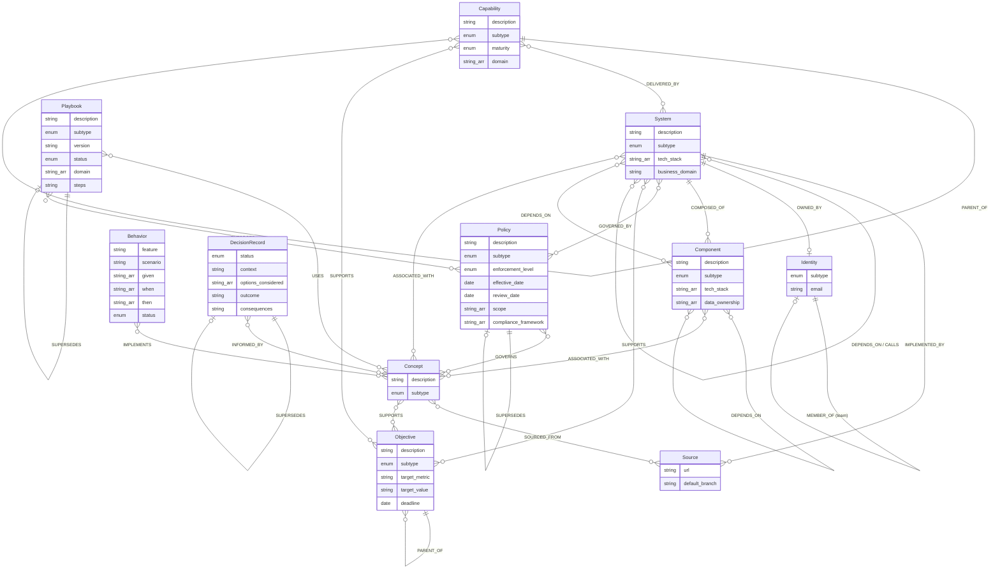

# Context Service Ontology

> Corrected for Draglass Editor on 2026-10-07. The eleven entity classes are retained. Historical ingestion/confidence sections describe the pilot, not automatic Draglass behavior. See the correction and suggestion notes at the end.

> Expanded from the PoC ontology, grounded in lockdown transcripts (Apr 13–16),
> the post-lockdown backlog meeting (Ram / Erez / Gabe), and the UFDX
> session. Every entity type below maps directly to something an
> organizational brain corpus must store or reason about.

## Design principles

1. **Knowledge-level, not file-level** - entity types represent what the
   organization *knows*, not individual files. Source material (SI docs,
   archetype outputs, config files, etc.) is ingested and decomposed into
   knowledge entities; raw files need not be graph nodes; Source notes may retain material as provenance anchors.
2. **Common Node Schema (CNS)** - every node shares a base schema:
   `id`, `fqn`, `name`, `type`, `subtype`, `tags`, `created_at`, `updated_at`,
   `sources`, `source_urls`, `confidence`, and `realization_status`.
   Type-specific properties are layered on top. This ensures uniform
   graph queries and full provenance traceability.
3. **Conflict rule** - team-curated knowledge (confidence 0.95) always
   wins over CS-generated knowledge (0.75). See the confidence table.
4. **Projection at query time** - structured outputs (AIFC context packs,
   AIFD input bundles) are assembled on the fly, not pre-materialized.
5. **Top-level discipline** - `Concept` is the default semantic atom.
   Stable structural entities with distinct lifecycle, ownership, or query
   patterns remain first-class top-level types. `Component` exists to
   capture internal architecture and keep `Concept` from becoming a
   catch-all bucket.

---

## Entity types at a glance

| Entity             | What it represents                                                              |
| ------------------ | ------------------------------------------------------------------------------- |
| **System**         | A canonical business system or application (iTAP_ID)                            |
| **Component**      | A structural element inside a System - not enterprise-tracked                   |
| **Source**     | A provenance anchor: GitHub, SharePoint, other platforms, or retained evidence                                |
| **Concept**        | An extracted piece of organizational knowledge (technical, business, or market) |
| **Identity**       | An actor: human, service account, or team                                       |
| **Behavior**       | A BDD-style behavioral spec (Given / When / Then)                               |
| **DecisionRecord** | A point-in-time architectural/organizational decision (ADR)                     |
| **Playbook**       | A repeatable process: archetype, skill, runbook, or SOP                         |
| **Policy**         | A governance rule: security, compliance, data, or regulatory mandate            |
| **Objective**      | A business goal, strategic intent, OKR, or KPI at any level                     |
| **Capability**     | A business or technical capability delivered by one or more systems             |

At the top level, the ontology spans enterprise anchors (`System`),
internal architecture (`Component`), provenance anchors (`Source`),
knowledge atoms (`Concept`), actors (`Identity`), executable intent
(`Behavior`), rationale (`DecisionRecord`), operational know-how
(`Playbook`), governance (`Policy`), business intent (`Objective`), and
delivery capability (`Capability`).

---

## 0 Common Node Schema (CNS)

Every entity in the corpus shares a common base schema - the **Common
Node Schema** (CNS). Type-specific fields are layered on top. This
mirrors the pattern discussed in the Operating Model session: CNS fields
are metadata that enable uniform graph queries across all node types;
everything below the CNS line is instance-specific.

| CNS Property | Type | Notes |
|--------------|------|-------|
| `id` | UUID | Unique node identifier |
| `fqn` | string | Fully qualified name - hierarchical, machine-interrogable (see convention below) |
| `name` | string | Human-readable display name |
| `type` | string | Entity type label: `System`, `Component`, `Source`, `Concept`, `Identity`, `Behavior`, `DecisionRecord`, `Playbook`, `Policy`, `Objective`, `Capability` |
| `subtype` | enum/string | Subtype within the entity type; one common field replaces type-specific subtype fields |
| `relationships` | collection | Named predicate/target records, each with optional evidence sources |
| `tags` | string[] | Freeform classification tags |
| `created_at` | ISO 8601 | When the node was first created in the corpus |
| `updated_at` | ISO 8601 | When the node was last modified |
| `sources` | string[] | Source systems that contributed to this node (e.g., `["ITAP", "GitHub"]`) |
| `source_urls` | string[] | URIs tracing back to origin material |
| `confidence` | float | Confidence score (see §3) |
| `realization_status` | enum | `DRAFT`, `ACTIVE`, `DEPRECATED`, `SUPERSEDED` - universal lifecycle state |

**FQN convention**: the FQN is a double-colon-delimited path whose first
segment identifies the entity type. It is both machine-parseable and
human-readable.

| Entity | FQN example |
|--------|-------------|
| System | `system::itap::12345` |
| Component | `component::billing::payments-db` |
| Source | `source::acme/billing` |
| Concept | `concept::billing::kafka-event-schema` |
| Identity | `identity::team::billing-core` |
| Behavior | `behavior::billing::discount-stacking` |
| DecisionRecord | `decision::2026-04-17::amdocs-option3` |
| Playbook | `playbook::archetype::app-maker::v3` |
| Policy | `policy::security::data-classification-standard` |
| Objective | `objective::strategic::2026::cost-transformation` |
| Capability | `capability::billing::real-time-rating` |

Below, each entity type section lists **only type-specific fields** -
CNS fields above are inherited by every node.

---

## Entity relationship diagram

All entities inherit the CNS base fields (`id`, `fqn`, `name`, `type`,
`tags`, `created_at`, `updated_at`, `sources`, `source_urls`,
`confidence`, `realization_status`). The diagram shows only
type-specific fields.



---

## 1 Entity types (detailed)

> Every entity inherits all **CNS fields** (§0). The tables below list
> only type-specific properties.

### System

The canonical business system or application (~200 for BSSe, sourced from
ITAP / MOT registry). A central architecture anchor; organizational identities, evidence and objectives may also stand independently. Distinguished from Components by
having an enterprise-registered identity (MOT_ID in ITAP).

| Property | Type | Notes |
|----------|------|-------|
| `description` | string | |
| `subtype` | enum | `APPLICATION`, `SERVICE`, `PLATFORM`, `EXTERNAL`, `PRODUCT` |
| `tech_stack` | string[] | from ITAP |
| `business_domain` | string | from ITAP |

### Component

A structural element inside a System that is not independently tracked in
the enterprise registry (no MOT_ID). Components represent the internal
architectural decomposition of a system: its databases, message queues,
modules, containers, serverless functions, and logical layers. They are
discovered from architecture documents, code analysis, and team knowledge
- not from ITAP.

Components can nest: a `MODULE` may contain a `DATABASE` and a `QUEUE`.
Lifecycle is tied to the parent System; components are not independently
governed at the enterprise level.

| Property | Type | Notes |
|----------|------|-------|
| `description` | string | what this component does |
| `subtype` | enum | `DATABASE`, `QUEUE`, `MODULE`, `LAYER`, `CONTAINER`, `FUNCTION`, `CACHE`, `GATEWAY` |
| `tech_stack` | string[] | technologies used (e.g., `["PostgreSQL"]`, `["Kafka"]`) |
| `data_ownership` | string[] | data domains this component owns (e.g., `["customer-accounts"]`) |

### Source

A provenance anchor that contains information. It may identify a platform collection (GitHub repository, SharePoint site) or a specific evidence item (page, document, email, chat or meeting report). It is deliberately broader than the former Repository entity. Extracted knowledge remains in the appropriate knowledge entity; retained source notes preserve original evidence.

Canonical subtypes: `GITHUB`, `SHAREPOINT`, `CONFLUENCE`, `GITLAB`, `AZURE_DEVOPS`, `ITAP`, `GIT`, `DOCUMENT`, `WEB_PAGE`, `EMAIL`, `CHAT`, `MEETING`, `DATASET`, `M365_REPORT`. `GIT` and `DOCUMENT` remain compatible with existing notes. Optional `format` can describe material such as markdown, pdf, or transcript without changing its platform subtype.

| Property | Type | Notes |
|----------|------|-------|
| `subtype` | enum | Platform or evidence subtype listed above |
| `url` | string | Original material or collection URL |
| `format` | string | Optional material format |
| `default_branch` | string | |

### Concept

An extracted piece of organizational knowledge - an API, business term,
technology, pattern, interface, or service name. Concepts are the core
knowledge atoms of the corpus: they are what gets surfaced when an
archetype or agent queries "what do we know about X?"

Concepts are extracted from source material (local-context MD, archetype
outputs, SI/TDD docs, wikis, Amdocs interface docs, tribal notes, etc.)
during ingestion. The source material can be retained as a Source provenance anchor;
`source_urls` on the Concept traces back to the origin file, page,
or record.

`Concept` remains intentionally broad, but it should not absorb stable
structural entities that already have dedicated top-level types. Internal
architecture belongs in `Component`; governance belongs in `Policy`;
business intent belongs in `Objective` and `Capability`.

| Property | Type | Notes |
|----------|------|-------|
| `description` | string | the extracted knowledge |
| `subtype` | enum | `API`, `BUSINESS_TERM`, `TECHNOLOGY`, `PATTERN`, `SERVICE_NAME`, `INTERFACE`, `REQUIREMENT`, `DIAGRAM`, `CONVENTION`, `CONSTRAINT`, `PROCESS_RULE`, `MARKET_INSIGHT`, `BUSINESS_INTELLIGENCE`, `STRATEGIC_INTENT`, `COMPETITIVE_ANALYSIS` |

### Identity

An actor - human user, service account, machine identity, or team.
Teams are modelled as Identities with `subtype = team`; individuals link to
teams via `MEMBER_OF`.

| Property | Type | Notes |
|----------|------|-------|
| `subtype` | enum | `PERSON`, `TEAM`, `DIVISION`, `COMPANY`, `SERVICE_ACCOUNT`, `MECH_ID` |
| `email` | string | optional |

### Behavior

A BDD-style behavioral specification expressed in Gherkin format:
`Given <precondition> / When <action> / Then <outcome>`. Behaviors are
the executable acceptance criteria of the corpus - they describe how a
system *should* behave under specific conditions. A Behavior typically
implements one or more Concepts of type `REQUIREMENT`.

| Property | Type | Notes |
|----------|------|-------|
| `feature` | string | the feature or capability this belongs to |
| `scenario` | string | scenario name |
| `given` | string[] | preconditions (Given steps) |
| `when` | string[] | actions / events (When steps) |
| `then` | string[] | expected outcomes (Then steps) |
| `status` | enum | `DRAFT`, `ACCEPTED`, `IMPLEMENTED`, `DEPRECATED` - BDD-specific lifecycle |

### DecisionRecord

A specific architectural or organizational decision (e.g., an ADR). Unlike
a Behavior (which specifies an expected outcome), a DecisionRecord captures a
point-in-time choice: the context, the options considered, the outcome,
and its consequences. Decision Records have a lifecycle (proposed →
accepted → deprecated → superseded).

| Property | Type | Notes |
|----------|------|-------|
| `status` | enum | `PROPOSED`, `ACCEPTED`, `DEPRECATED`, `SUPERSEDED` - ADR-specific lifecycle |
| `context` | string | why this decision was needed |
| `options_considered` | string[] | what alternatives were evaluated |
| `outcome` | string | the decision that was made |
| `consequences` | string | what it means for implementation |

### Playbook

A repeatable, executable process - an archetype, a skill, a runbook, or a
standard operating procedure. Playbooks are first-class because the
lockdown and UFDX discussions showed that archetypes (76+ certified, plus
team-local variants) are core intellectual property. They define *how*
work gets done: how to extract knowledge, how to produce an SI, how to
code a feature, how to run a deployment. Blue Pearl calls them "skills";
AIFC/AIFD calls them "archetypes"; operationally they may be runbooks.

Playbooks have versions (tracked via `version` + `source_urls` pointing to
a commit), a certification status, and scoping to specific domains or
systems.

| Property | Type | Notes |
|----------|------|-------|
| `description` | string | what this playbook does |
| `subtype` | enum | `ARCHETYPE`, `SKILL`, `RUNBOOK`, `SOP`, `PIPELINE` |
| `version` | string | semantic version or commit ref |
| `status` | enum | `DRAFT`, `CERTIFIED`, `DEPRECATED` - certification lifecycle |
| `domain` | string[] | applicable domains (e.g., `billing`, `network`) - empty = universal |
| `steps` | string | high-level step summary (or pointer to full content) |

### Policy

A governance rule - security standard, compliance requirement, data
governance policy, or external regulation. Policies are first-class
because they constrain what systems can do, how data is handled, and
what decisions are permissible. Unlike Concepts (which describe *what we
know*), Policies describe *what we must do*. Regulations are modelled as
Policies with `subtype = REGULATION` and an external governing body.

Policies have a lifecycle: draft → active → under_review → retired (mapped
to the CNS `realization_status`). They also carry enforcement metadata
and review cadence.

| Property | Type | Notes |
|----------|------|-------|
| `description` | string | what this policy mandates |
| `subtype` | enum | `SECURITY`, `COMPLIANCE`, `DATA_GOVERNANCE`, `OPERATIONAL`, `REGULATION` |
| `enforcement_level` | enum | `MANDATORY`, `RECOMMENDED`, `ADVISORY` |
| `effective_date` | ISO 8601 date | when the policy takes effect |
| `review_date` | ISO 8601 date | next scheduled review |
| `scope` | string[] | what this applies to (e.g., `["all-systems"]`, `["billing"]`, `["PII-data"]`) |
| `compliance_framework` | string[] | frameworks this satisfies (e.g., `["SOX"]`, `["PCI-DSS"]`, `["GDPR"]`) |
| `governing_body` | string | issuing authority (internal team or external regulator) |

### Objective

A business goal, strategic intent, OKR, or KPI at any level of the
organization. Objectives are hierarchical: strategic goals decompose into
tactical goals, which decompose into operational targets. This entity
captures the *why* behind systems, decisions, and knowledge - enabling
queries like "which systems support our cost-transformation goal?" or
"what concepts relate to our Q3 revenue target?"

| Property | Type | Notes |
|----------|------|-------|
| `description` | string | what this objective aims to achieve |
| `subtype` | enum | `STRATEGIC`, `TACTICAL`, `OPERATIONAL` |
| `target_metric` | string | what is being measured (e.g., `cost_reduction_pct`, `time_to_market_days`) |
| `target_value` | string | the target (e.g., `30%`, `< 90 days`) |
| `deadline` | ISO 8601 date | when the objective should be met |

### Capability

A business or technical capability - what the organization *can do*.
Capabilities are the bridge between Objectives ("why") and Systems
("how"): "we need capability X to achieve goal Y, and systems A+B+C
deliver it." Capabilities are hierarchical (e.g., "Customer Management"
→ "Customer Onboarding" → "Identity Verification") and span multiple
systems. Essential for BSSe transformation: mapping current-state
capabilities to future-state, identifying gaps.

| Property | Type | Notes |
|----------|------|-------|
| `description` | string | what this capability enables |
| `subtype` | enum | `STRATEGIC`, `TACTICAL`, `OPERATIONAL` |
| `maturity` | enum | `PLANNED`, `DEVELOPING`, `OPERATIONAL`, `DECOMMISSIONING` |
| `domain` | string[] | applicable business domains (e.g., `["billing"]`, `["network"]`) |

---

## 2 Relationship types (edges)

Named edges live in each note's `relationships` collection. `relation` and `target` are required; `sources` is an optional collection of evidence records. Each source can carry `ref` (a wiki link or URL), `locator`, `quote`, `observed_at`, and additional provenance fields. Optional `confidence` and `created_at` belong to the relationship. A wiki link without a relationship declaration is an unnamed connection, and missing targets remain visible hollow nodes.

```yaml
relationships:
  - relation: member_of
    target: "[[Teams/ABC]]"
    sources:
      - ref: "[[Sources/Organization chart]]"
        locator: Engineering / ABC
        quote: "Erez is a member of ABC."
```

Predicate spellings in this reference use uppercase for Cypher; Draglass writes lowercase snake_case. Inverses are equivalent navigable views of the same evidence-backed relationship. Source collections are never mandatory and are never fabricated.

| Edge | From → To | Meaning |
|------|-----------|---------|
| `IMPLEMENTED_BY` | System → Source | this repo implements this system |
| `COMPOSED_OF` | System → Component | this system contains this component |
| `COMPOSED_OF` | Component → Component | nested containment within a component |
| `DEPENDS_ON` | System → System | architectural dependency |
| `DEPENDS_ON` | Component → Component | internal dependency between components |
| `DEPENDS_ON` | Component → System | component depends on an external system |
| `CALLS` | System → System | runtime invocation (from Dynatrace/Sparks) |
| `OWNED_BY` | System → Identity (team) | team ownership |
| `MEMBER_OF` | Identity (PERSON) → Identity (TEAM) | team membership |
| `EMPLOYED_BY` | Identity (PERSON) → Identity (COMPANY) | employment |
| `REPORTS_TO` | Identity (PERSON) → Identity (PERSON) | management reporting |
| `PART_OF` | Identity → Identity | organizational containment, including team/division/company |
| `LEADS` | Identity (PERSON) → Identity | leadership |
| `ASSOCIATED_WITH` | Concept ↔ System | this concept relates to this system |
| `ASSOCIATED_WITH` | Concept ↔ Component | this concept relates to this component |
| `SOURCED_FROM` | Concept → Source | this concept was extracted from this repo |
| `IMPLEMENTS` | Behavior → Concept | this behavior implements this requirement / convention |
| `SUPERSEDES` | DecisionRecord → DecisionRecord | this decision replaces that one |
| `INFORMED_BY` | DecisionRecord → Concept | this decision considered this knowledge |
| `USES` | Playbook → Concept | this playbook references this knowledge |
| `SUPERSEDES` | Playbook → Playbook | new version replaces old |
| `ENFORCES` | Playbook → Policy | this playbook operationalizes / enforces this policy |
| `GOVERNED_BY` | System → Policy | this system must comply with this policy |
| `GOVERNS` | Policy → Concept | this policy constrains this knowledge area |
| `SUPERSEDES` | Policy → Policy | new policy replaces old |
| `SUPPORTS` | any → Objective | this entity supports this business goal |
| `PARENT_OF` | Objective → Objective | goal hierarchy (strategic → tactical → operational) |
| `DELIVERED_BY` | Capability → System | this system delivers this capability |
| `PARENT_OF` | Capability → Capability | capability decomposition hierarchy |
| `SUPPORTS` | Capability → Objective | this capability supports this business goal |

Note: Behavior, DecisionRecord, and Playbook reach Systems and Components
transitively through their Concept links (`IMPLEMENTS`, `INFORMED_BY`,
`USES`) and `ASSOCIATED_WITH`. Policy links directly to Systems via
`GOVERNED_BY` and to knowledge domains via `GOVERNS`. Components inherit
governance from their parent System. Objectives link to any entity via
`SUPPORTS`. No redundant edges needed.

---

## 3 Confidence scoring

Derived from the conflict-resolution rules discussed in the post-lockdown
meeting (Erez: "team-committed local context always wins").

| Source | `confidence` | Rationale |
|--------|-------------|-----------|
| ITAP / MOT registry | 1.0 | Authoritative system-of-record |
| Team-curated knowledge | 0.95 | Curated by owning team |
| CS-generated archetype output | 0.75 | Machine-generated, not team-reviewed |
| Shanks static graph | 0.6 | Full-codebase analysis, but stale risk |
| Amdocs interface docs (Option 3) | 0.5 | External vendor, interface only |
| Tribal knowledge / transcripts | 0.4 | Unstructured, may be outdated |

**Conflict rule**: when two nodes share the same `fqn`, the
higher-confidence node wins. If equal, the more recently ingested node
wins. Curator can force override with recorded rationale.

---

## 4 Freshness TTL

| Entity / knowledge type | Default TTL | Rationale |
|------------------------|-------------|-----------|
| System metadata | 90 days | ITAP updates quarterly |
| Component | 14 days | Discovered from architecture docs and code; refreshed by re-analysis |
| Concept from code analysis | 7 days | Code changes frequently |
| Concept from team-curated context | 14 days | Refreshed by archetype re-runs |
| Concept from SI / TDD | 30 days | Design docs change less often |
| Concept from tribal knowledge | 90 days | Rarely refreshed |
| Behavior | 90 days | Specs may evolve as requirements change |
| DecisionRecord | ∞ (never stale) | Decisions are historical record; supersede, don't expire |
| Playbook | 30 days | Archetypes evolve with each sprint; re-check for new certified versions |
| Policy | 180 days | Policies reviewed semi-annually; regulations may have longer cycles |
| Objective | 90 days | Goals reviewed quarterly; OKRs refresh each cycle |
| Capability | 90 days | Capability maps reviewed quarterly; maturity tracked per planning cycle |

Stale nodes (past TTL) can be overwritten by lower-confidence sources.

---

## 5 Ingestion gates

- **Creation gate**: resolve `fqn`; if no existing node, create.
  If existing node is present, merge only when incoming `confidence` >=
  existing OR existing node is stale (past TTL).
- **Update gate**: require `confidence_delta >= 0.05` or curator override.
  Rationale is recorded in `sources` / `source_urls`.
- **Provenance chain**: every ingestion appends to `sources`,
  `source_urls` and updates `updated_at` so the full lineage
  is traceable back to the original material.

---

## 6 Ingestion: how source material maps to entities

Source material (files, exports, transcripts) is **ingested and
decomposed** into knowledge entities. Source notes can retain raw evidence as provenance anchors; extracted knowledge is represented by the other entity classes.

| Source material | Produces | How |
|-----------------|----------|-----|
| ITAP / MOT registry | `System` nodes (subtype, tech_stack, business_domain) | Bulk import; fqn = `system::itap::<mot_id>` |
| GitHub repos (code) | `Source` nodes | Repo metadata import |
| Local-context MD files | `Concept` nodes and, when explicitly described, `Component` nodes | Parse MD, extract knowledge atoms and internal structure; `source_urls` includes file path |
| Architecture docs / diagrams | `Component` nodes + `COMPOSED_OF` / `DEPENDS_ON` edges | Parse structural decomposition, interfaces, and nesting |
| Archetype outputs (AIFC) | `Concept` nodes, `Component` nodes when internal structure is explicit, and `DEPENDS_ON` edges | Parse frontmatter for `system_ids`, extracted entities, and structural hints |
| SI documents (AIFD) | `Concept` nodes plus `Component` nodes when the design names internal building blocks | Parse SI, extract requirements, interfaces, and structure |
| TDD documents (AIFD) | `Concept` nodes plus `Component` nodes for modules, stores, queues, or services named in the design | Parse TDD, extract implementation knowledge and internal architecture |
| Amdocs interface docs | `Concept` nodes (subtype `INTERFACE`, confidence 0.5) | Parse interface specs; tag `amdocs_interface=true` |
| Sparks / LeanIX | `System` nodes + `DEPENDS_ON` / `CALLS` edges | JSON export → parser |
| Shanks' static graph | `Component` nodes, `DEPENDS_ON` edges, and supporting `Concept` nodes when useful | Graph export → merge |
| Wikis / Confluence | `Concept` nodes and, when stable structure is documented, `Component` nodes | Wiki-sync pipeline; `source_urls` includes wiki page URL |
| Dynatrace | `CALLS` edges between Systems | Trace export → edge creation |
| Tribal knowledge | `Concept` nodes (confidence 0.4) | Manual upload or transcript extraction |
| ADR files / decision docs | `DecisionRecord` nodes | Parse ADR format; extract context, options, outcome |
| Convention / standard docs | `Concept` nodes (subtype `CONVENTION`, `CONSTRAINT`, `PROCESS_RULE`) | Parse and extract as knowledge |
| BDD feature files / Gherkin specs | `Behavior` nodes | Parse Given/When/Then; link to requirement Concepts via `IMPLEMENTS` |
| Archetype / skill MD files | `Playbook` nodes | Parse archetype frontmatter; version from commit |
| Runbooks / SOPs | `Playbook` nodes (subtype `RUNBOOK` / `SOP`) | Parse and ingest |
| Security / compliance policy docs | `Policy` nodes | Parse policy docs; set subtype, enforcement_level, compliance_framework |
| Regulatory mandates | `Policy` nodes (subtype `REGULATION`) | External source; set governing_body, effective_date |
| Strategic plans / OKR docs | `Objective` nodes | Parse goal hierarchy; link parent objectives |
| EA capability models / TOGAF maps | `Capability` nodes | Parse capability hierarchy; link to systems via `DELIVERED_BY` |
| Market research / competitive analysis | `Concept` nodes (subtype `MARKET_INSIGHT`, `COMPETITIVE_ANALYSIS`) | Parse and extract as knowledge atoms |
| Databricks pipelines | *(orchestration - not stored as entities)* | Runs the pipelines that create nodes |

---

## 7 Archetype mapping rules

How AIFC / AIFD archetype outputs map to the ontology:

1. **Extracted entities** within archetype output → `Concept` nodes by
   default; when the output explicitly names stable internal building
   blocks, create `Component` nodes as well. Link semantic knowledge via
   `ASSOCIATED_WITH` to the relevant `System` or `Component`, and
   `SOURCED_FROM` to the `Source`. Append origin path to `source_urls`.

2. **Impacted apps list** (`impacted_systems` in frontmatter) → create or
   merge `System` nodes and `DEPENDS_ON` edges.

3. **Local-context files** committed to repo → `Concept` nodes, plus
   `Component` nodes when the file describes internal modules, stores,
   queues, databases, or gateways with stable names and responsibilities.
   `sources` includes `GitHub-local-context`; team-curated content keeps
   `confidence = 0.95`.

4. **AIFD outputs** (SI, TDD) → `Concept` nodes extracted from the design
   documents, and `Component` nodes when the design explicitly decomposes
   the system into internal parts, with `confidence = 0.75` and
   `source_urls` pointing to the SI/TDD file.

5. **Decisions found in SI/TDD** → `DecisionRecord` nodes with
   `source_urls` pointing to the design document.

6. **Archetype definitions** (skill Markdown files) → `Playbook` nodes
   with `subtype = ARCHETYPE`, `version` from commit SHA, and
   `status = CERTIFIED` if peer-reviewed. Link via `USES` to referenced
   Concepts.

---

## 8 Amdocs handling (Option 3)

Per lockdown decision: ingest Amdocs **interface documentation only** (no
source code). Concepts extracted from Amdocs docs are tagged with:

- `sources` includes `Amdocs_Interface`
- `amdocs_interface = true` (in tags)
- `confidence = 0.5`

Do NOT use Amdocs-derived knowledge as authoritative for automated PRs or
code edits. Consumers filter or downweight by the `amdocs_interface` tag.

---

## 9 Examples

### System node

```json
{
  "type": "System",
  "id": "system:mot:12345",
  "fqn": "system::itap::12345",
  "name": "Billing Engine",
  "tags": [
    "billing",
    "core"
  ],
  "created_at": "2026-04-17T12:00:00Z",
  "updated_at": "2026-04-17T12:00:00Z",
  "sources": [
    "ITAP"
  ],
  "source_urls": [
    "https://itap.corp/systems/12345"
  ],
  "confidence": 1.0,
  "realization_status": "ACTIVE",
  "subtype": "APPLICATION",
  "tech_stack": [
    "Java",
    "Oracle",
    "Kafka"
  ],
  "business_domain": "Billing",
  "relationships": [
    {
      "relation": "owned_by",
      "target": "identity:team:billing-core"
    }
  ]
}
```


### Component node

```json
{
  "type": "Component",
  "id": "component:billing:rating-engine",
  "fqn": "component::billing::rating-engine",
  "name": "Rating Engine",
  "tags": [
    "billing",
    "rating",
    "core"
  ],
  "created_at": "2026-04-17T12:05:00Z",
  "updated_at": "2026-04-17T12:05:00Z",
  "sources": [
    "GitHub-local-context",
    "AIFD-TDD"
  ],
  "source_urls": [
    "https://github.com/acme/billing/blob/main/context/components.md",
    "https://github.com/acme/billing/blob/main/design/rating-engine-tdd.md"
  ],
  "confidence": 0.95,
  "realization_status": "ACTIVE",
  "description": "Internal module that evaluates pricing rules, discount sequencing, and charge construction before bill assembly.",
  "subtype": "MODULE",
  "tech_stack": [
    "Java",
    "Drools"
  ],
  "data_ownership": [
    "usage-events",
    "pricing-rules"
  ],
  "relationships": [
    {
      "relation": "component_of",
      "target": "system::itap::12345"
    }
  ]
}
```

### Concept node (extracted from local context)

```json
{
  "type": "Concept",
  "id": "concept:billing-kafka-event-schema",
  "fqn": "concept::billing::kafka-event-schema",
  "name": "Billing Kafka event schema",
  "tags": [
    "kafka",
    "events",
    "avro"
  ],
  "created_at": "2026-04-17T12:10:00Z",
  "updated_at": "2026-04-17T12:10:00Z",
  "sources": [
    "GitHub-local-context"
  ],
  "source_urls": [
    "https://github.com/acme/billing/blob/main/context/overview.md"
  ],
  "confidence": 0.95,
  "realization_status": "ACTIVE",
  "description": "Events use Avro with schema registry; key = accountId; partition by region.",
  "subtype": "PATTERN",
  "relationships": []
}
```

### DecisionRecord node

```json
{
  "type": "DecisionRecord",
  "id": "dr:adr-2026-04-17-amdocs-option3",
  "fqn": "decision::2026-04-17::amdocs-option3",
  "name": "Amdocs integration - interface docs only (Option 3)",
  "tags": [
    "amdocs",
    "integration",
    "lockdown"
  ],
  "created_at": "2026-04-17T14:00:00Z",
  "updated_at": "2026-04-17T14:00:00Z",
  "sources": [
    "ManualUpload"
  ],
  "source_urls": [
    "https://github.com/contextup/lockdown/blob/main/ADR-2026-04-17-amdocs.md"
  ],
  "confidence": 1.0,
  "realization_status": "ACTIVE",
  "status": "ACCEPTED",
  "context": "Amdocs source code is behind a contractual firewall. Need to decide how much Amdocs knowledge to ingest into the corpus.",
  "options_considered": [
    "Option 1: Full source access (blocked by contract)",
    "Option 2: Shanks-style static graph over Amdocs code (blocked)",
    "Option 3: Interface documentation only"
  ],
  "outcome": "Option 3 - ingest interface docs only at conservative confidence.",
  "consequences": "Amdocs content tagged confidence=0.5; cannot be used for automated code generation; design-phase suggestions only.",
  "relationships": []
}
```

### Playbook node (archetype)

```json
{
  "type": "Playbook",
  "id": "playbook:archetype:app-maker:v3",
  "fqn": "playbook::archetype::app-maker::v3",
  "name": "App Maker",
  "tags": [
    "coding",
    "web",
    "scaffold"
  ],
  "created_at": "2026-04-17T13:00:00Z",
  "updated_at": "2026-04-17T13:00:00Z",
  "sources": [
    "GitHub"
  ],
  "source_urls": [
    "https://github.com/cdo/archetypes/blob/main/app-maker/ARCHETYPE.md"
  ],
  "confidence": 0.95,
  "realization_status": "ACTIVE",
  "description": "Archetype for developing web-based applications. Covers scaffolding, component wiring, API integration, and test generation.",
  "subtype": "ARCHETYPE",
  "version": "3.0.0",
  "status": "CERTIFIED",
  "domain": [
    "application-development"
  ],
  "relationships": []
}
```

### Behavior node (Gherkin spec)

```json
{
  "type": "Behavior",
  "id": "behavior:billing:discount-stacking",
  "fqn": "behavior::billing::discount-stacking",
  "name": "Discount stacking on multi-line orders",
  "tags": [
    "billing",
    "discounts",
    "multi-line"
  ],
  "created_at": "2026-04-17T14:00:00Z",
  "updated_at": "2026-04-17T14:00:00Z",
  "sources": [
    "GitHub"
  ],
  "source_urls": [
    "https://github.com/acme/billing/blob/main/specs/discount-stacking.feature"
  ],
  "confidence": 0.95,
  "realization_status": "ACTIVE",
  "feature": "Billing discount engine",
  "scenario": "Two eligible discounts on a three-line wireless order",
  "given": [
    "a wireless account with 3 active lines",
    "discount A (autopay 10%) is active",
    "discount B (multi-line $10/line) is eligible"
  ],
  "when": [
    "the billing engine calculates the monthly charge"
  ],
  "then": [
    "both discounts are applied",
    "autopay discount is calculated on the base price",
    "multi-line discount is applied after autopay",
    "the total reflects both discounts without double-dipping"
  ],
  "status": "ACCEPTED",
  "relationships": []
}
```

### Policy node (security standard)

```json
{
  "type": "Policy",
  "id": "policy:sec:data-classification",
  "fqn": "policy::security::data-classification-standard",
  "name": "Data Classification Standard",
  "tags": [
    "security",
    "data-governance",
    "PII"
  ],
  "created_at": "2026-01-15T09:00:00Z",
  "updated_at": "2026-04-01T10:00:00Z",
  "sources": [
    "Confluence",
    "ManualUpload"
  ],
  "source_urls": [
    "https://wiki.corp/security/data-classification-v3"
  ],
  "confidence": 1.0,
  "realization_status": "ACTIVE",
  "description": "All data assets must be classified as Public, Internal, Confidential, or Restricted. PII is always Restricted. Classification drives encryption-at-rest and access-control requirements.",
  "subtype": "DATA_GOVERNANCE",
  "enforcement_level": "MANDATORY",
  "effective_date": "2025-06-01",
  "review_date": "2026-06-01",
  "scope": [
    "all-systems",
    "PII-data"
  ],
  "compliance_framework": [
    "SOX",
    "PCI-DSS"
  ],
  "governing_body": "Enterprise Security Office",
  "relationships": []
}
```

### Objective node (strategic goal)

```json
{
  "type": "Objective",
  "id": "obj:strategic:2026:cost-xform",
  "fqn": "objective::strategic::2026::cost-transformation",
  "name": "BSSe Cost Transformation",
  "tags": [
    "strategic",
    "cost",
    "BSSe",
    "2026"
  ],
  "created_at": "2026-01-10T08:00:00Z",
  "updated_at": "2026-04-15T14:00:00Z",
  "sources": [
    "ManualUpload"
  ],
  "source_urls": [
    "https://wiki.corp/strategy/2026-bsse-transformation"
  ],
  "confidence": 0.95,
  "realization_status": "ACTIVE",
  "description": "Reduce BSSe total cost of ownership by 30% through modernization, decommissioning legacy systems, and shifting to cloud-native architecture.",
  "subtype": "STRATEGIC",
  "target_metric": "cost_reduction_pct",
  "target_value": "30%",
  "deadline": "2027-12-31",
  "relationships": [
    {
      "relation": "owned_by",
      "target": "identity:team:bsse-leadership"
    }
  ]
}
```

### Capability node

```json
{
  "type": "Capability",
  "id": "cap:billing:real-time-rating",
  "fqn": "capability::billing::real-time-rating",
  "name": "Real-Time Rating",
  "tags": [
    "billing",
    "rating",
    "real-time"
  ],
  "created_at": "2026-03-01T10:00:00Z",
  "updated_at": "2026-04-15T11:00:00Z",
  "sources": [
    "ManualUpload",
    "ITAP"
  ],
  "source_urls": [
    "https://wiki.corp/ea/capability-map/billing"
  ],
  "confidence": 0.95,
  "realization_status": "ACTIVE",
  "description": "Ability to calculate charges for voice, data, and messaging events in real time as usage occurs, supporting prepaid and postpaid models.",
  "subtype": "OPERATIONAL",
  "maturity": "OPERATIONAL",
  "domain": [
    "billing"
  ],
  "relationships": [
    {
      "relation": "owned_by",
      "target": "identity:team:billing-core"
    },
    {
      "relation": "child_of",
      "target": "capability::billing::billing-core"
    }
  ]
}
```

### Edge examples (Cypher)

```cypher
// System implemented by repo
(:System {fqn:'system::itap::12345'})
  -[:IMPLEMENTED_BY {confidence:0.95}]->
(:Source {fqn:'source::acme/billing'})

// Concept extracted from repo
(:Concept {fqn:'concept::billing::kafka-event-schema'})
  -[:SOURCED_FROM {confidence:0.95}]->
(:Source {fqn:'source::acme/billing'})

// System composed of component
(:System {fqn:'system::itap::12345'})
  -[:COMPOSED_OF {confidence:0.95}]->
(:Component {fqn:'component::billing::rating-engine'})

// Concept associated with system
(:Concept {fqn:'concept::billing::kafka-event-schema'})
  -[:ASSOCIATED_WITH]->
(:System {fqn:'system::itap::12345'})

// Concept associated with component
(:Concept {fqn:'concept::billing::discount-sequencing-rule'})
  -[:ASSOCIATED_WITH]->
(:Component {fqn:'component::billing::rating-engine'})

// Decision informed by concept
(:DecisionRecord {fqn:'decision::2026-04-17::amdocs-option3'})
  -[:INFORMED_BY]->
(:Concept {fqn:'concept::amdocs::billing-interface'})

// Behavior implements a requirement concept
(:Behavior {fqn:'behavior::billing::discount-stacking'})
  -[:IMPLEMENTS]->
(:Concept {subtype:'REQUIREMENT', fqn:'concept::billing::discount-stacking-req'})

// Playbook uses a concept
(:Playbook {fqn:'playbook::archetype::app-maker::v3'})
  -[:USES]->
(:Concept {fqn:'concept::billing::kafka-event-schema'})

// Playbook enforces a policy
(:Playbook {fqn:'playbook::sop::change-management::v2'})
  -[:ENFORCES]->
(:Policy {fqn:'policy::compliance::sox-change-management'})

// System governed by policy
(:System {fqn:'system::itap::12345'})
  -[:GOVERNED_BY]->
(:Policy {fqn:'policy::security::data-classification-standard'})

// Objective hierarchy
(:Objective {fqn:'objective::strategic::2026::cost-transformation'})
  -[:PARENT_OF]->
(:Objective {fqn:'objective::tactical::2026::decom-legacy-billing'})

// System supports objective
(:System {fqn:'system::itap::12345'})
  -[:SUPPORTS]->
(:Objective {fqn:'objective::strategic::2026::cost-transformation'})

// Capability delivered by system
(:Capability {fqn:'capability::billing::real-time-rating'})
  -[:DELIVERED_BY]->
(:System {fqn:'system::itap::12345'})

// Capability hierarchy
(:Capability {fqn:'capability::billing::billing-core'})
  -[:PARENT_OF]->
(:Capability {fqn:'capability::billing::real-time-rating'})

// Capability supports objective
(:Capability {fqn:'capability::billing::real-time-rating'})
  -[:SUPPORTS]->
(:Objective {fqn:'objective::strategic::2026::cost-transformation'})
```

---

## 10 Query patterns

**All knowledge for a system** (what AIFC/AIFD needs, including internal structure):
```cypher
MATCH (s:System {fqn: $system_fqn})
OPTIONAL MATCH (s)-[:IMPLEMENTED_BY]->(r:Source)
OPTIONAL MATCH (s)-[:COMPOSED_OF]->(rootComp:Component)
OPTIONAL MATCH (rootComp)-[:COMPOSED_OF*0..3]->(nestedComp:Component)
WITH s, collect(DISTINCT r) AS repos,
     [c IN collect(DISTINCT rootComp) + collect(DISTINCT nestedComp) WHERE c IS NOT NULL] AS components
OPTIONAL MATCH (sysConcept:Concept)-[:ASSOCIATED_WITH]->(s)
OPTIONAL MATCH (compConcept:Concept)-[:ASSOCIATED_WITH]->(comp:Component)
WHERE comp IN components
WITH s, repos, components,
     [c IN collect(DISTINCT sysConcept) + collect(DISTINCT compConcept) WHERE c IS NOT NULL] AS concepts
OPTIONAL MATCH (b:Behavior)-[:IMPLEMENTS]->(c:Concept)
WHERE c IN concepts
OPTIONAL MATCH (d:DecisionRecord)-[:INFORMED_BY]->(c2:Concept)
WHERE c2 IN concepts
OPTIONAL MATCH (p:Playbook)-[:USES]->(c3:Concept)
WHERE c3 IN concepts
RETURN s, repos, components, concepts,
       collect(DISTINCT b) AS behaviors,
       collect(DISTINCT d) AS decisions,
       collect(DISTINCT p) AS playbooks
```

**Component map for a system**:
```cypher
MATCH path = (s:System {fqn: $system_fqn})-[:COMPOSED_OF*1..5]->(comp:Component)
RETURN path
```

**Knowledge for a component**:
```cypher
MATCH (comp:Component {fqn: $component_fqn})
OPTIONAL MATCH (c:Concept)-[:ASSOCIATED_WITH]->(comp)
OPTIONAL MATCH (depComp:Component)-[:DEPENDS_ON]->(comp)
OPTIONAL MATCH (comp)-[:DEPENDS_ON]->(ext:System)
RETURN comp,
       collect(DISTINCT c) AS concepts,
       collect(DISTINCT depComp) AS inbound_component_dependencies,
       collect(DISTINCT ext) AS external_system_dependencies
```

**Behaviors implementing a requirement**:
```cypher
MATCH (b:Behavior)-[:IMPLEMENTS]->(c:Concept {fqn: $req_fqn})
WHERE c.subtype = 'REQUIREMENT'
RETURN b ORDER BY b.status, b.name
```

**System dependency chain** (impact analysis):
```cypher
MATCH path = (s:System {fqn: $system_fqn})-[:DEPENDS_ON|CALLS*1..5]->(dep:System)
RETURN path
```

**Component dependency chain** (internal impact analysis):
```cypher
MATCH path = (c:Component {fqn: $component_fqn})-[:DEPENDS_ON*1..5]->(dep)
RETURN path
```

**Stale knowledge** (librarian dashboard):
```cypher
MATCH (c:Concept)
WHERE c.updated_at < datetime() - duration({days: 14})
  AND 'GitHub-local-context' IN c.sources
RETURN c.fqn, c.name, c.updated_at
ORDER BY c.updated_at ASC
```

**Active decisions for a system** (traverses through Concept):
```cypher
MATCH (d:DecisionRecord)-[:INFORMED_BY]->(c:Concept)-[:ASSOCIATED_WITH]->(s:System {fqn: $system_fqn})
WHERE d.status = 'ACCEPTED'
RETURN d ORDER BY d.updated_at DESC
```

**Active decisions for a component**:
```cypher
MATCH (d:DecisionRecord)-[:INFORMED_BY]->(c:Concept)-[:ASSOCIATED_WITH]->(comp:Component {fqn: $component_fqn})
WHERE d.status = 'ACCEPTED'
RETURN d ORDER BY d.updated_at DESC
```

**Certified playbooks for a domain**:
```cypher
MATCH (p:Playbook)
WHERE p.status = 'CERTIFIED'
  AND 'billing' IN p.domain
RETURN p ORDER BY p.version DESC
```

**Policies governing a system**:
```cypher
MATCH (s:System {fqn: $system_fqn})-[:GOVERNED_BY]->(pol:Policy)
WHERE pol.realization_status = 'ACTIVE'
RETURN pol ORDER BY pol.enforcement_level, pol.name
```

**Goal decomposition** (objective tree):
```cypher
MATCH path = (root:Objective)-[:PARENT_OF*1..5]->(leaf:Objective)
WHERE root.fqn = $root_objective_fqn
RETURN path
```

**What supports a strategic objective?**:
```cypher
MATCH (n)-[:SUPPORTS]->(obj:Objective {fqn: $objective_fqn})
RETURN labels(n)[0] AS entity_type, n.fqn, n.name
ORDER BY entity_type, n.name
```

**Capability map for a domain** (which systems deliver which capabilities):
```cypher
MATCH (cap:Capability)-[:DELIVERED_BY]->(s:System)
WHERE $domain IN cap.domain
RETURN cap.fqn, cap.name, cap.maturity, collect(s.name) AS systems
ORDER BY cap.subtype, cap.name
```

**Capability gap analysis** (planned but not yet operational):
```cypher
MATCH (cap:Capability)
WHERE cap.maturity IN ['PLANNED', 'DEVELOPING']
OPTIONAL MATCH (cap)-[:SUPPORTS]->(obj:Objective)
RETURN cap.fqn, cap.name, cap.maturity, collect(obj.name) AS objectives
ORDER BY cap.maturity, cap.name
```

---

## 11 Storage strategy (pilot)

- **Graph layer** (Neo4j or Neptune): all entity nodes and edges. Fast
  traversals for dependency chains, component maps, system and component
  impact analysis, and context assembly.
- **Document + vector layer** (S3/Blob + embeddings index): `description`
  fields and longer textual content. Enables semantic search over
  Concept descriptions, Component descriptions, Behavior Given/When/Then
  steps, and DecisionRecord context/outcome fields.
- **Canonical metadata** lives in the graph; `source_urls` on every node
  traces back to the original material for full provenance.

---

## 12 What this ontology deliberately excludes

| Excluded concept | Why |
|------------------|-----|
| Separate SourceFile / Document class | Evidence notes can use Source; no extra top-level class is required. |
| Pre-materialized projections | Assembled at query time from stored nodes |
| ChangeSet / commit entity | Provenance captured via `source_urls` pointing to specific commits |
| DependencyEdge entity | Modelled as typed edges (`DEPENDS_ON`, `CALLS`) |
| Artifact entity | Knowledge extracted into Concepts; the artifact is raw input |

---

## Next steps

1. Review with Erez, Snir, and the Librarian/curator team.
2. Produce JSON Schema or Graph DDL for the eleven entity types.
3. Draft the first ingestion pipeline (Phase Zero: parse existing local-
   context MD files and extract Concept nodes, plus Component nodes when
   stable internal structure is explicitly described).

## Draglass corrections and mapping

- `Repository` is now `Source`; legacy Repository/GIT notes remain readable.
- Every subtype uses `subtype`. Legacy concept_type, playbook_type, policy_type, objective_level and capability_level remain readable aliases, not template fields.
- HUMAN is accepted as a legacy spelling of Identity/PERSON. Identities include TEAM, DIVISION and COMPANY.
- System/EXTERNAL and Concept/SERVICE_NAME and DIAGRAM are retained. Actual repeatable runbooks use Playbook/RUNBOOK, rather than duplicating operational procedures as Concept/RUNBOOK.
- DecisionRecord subtypes: ARCHITECTURAL, TECHNICAL, PRODUCT, ORGANIZATIONAL. Behavior subtypes: SCENARIO, ACCEPTANCE_CRITERION, BUSINESS_RULE.
- Capability uses the documented STRATEGIC, TACTICAL, OPERATIONAL subtypes. Existing BUSINESS/TECHNICAL subtypes remain available; `level` can independently record hierarchy for those notes.
- `owned_by`, `component_of`, `child_of` and `supersedes` are named relationships with optional evidence. New templates do not duplicate their targets in owner, parent_system, parent or supersedes scalar fields. Existing fields remain readable.
- Corrected SOURCED_FROM, GOVERNED_BY and SUPPORTS diagram directions, and PARENT_OF examples/query direction. Parent points to child; child_of is its inverse.
- CNS `id` was declared UUID but examples used arbitrary strings. Draglass creates UUIDs and retains existing IDs. FQN is a stable initial type/subtype/name identifier; it is not regenerated on file moves.
- A draft does not assert confidence, ownership, membership, verification or an ACTIVE lifecycle. Empty facts and evidence stay empty; review supplies actual knowledge.

## Suggestions for a future ontology revision (not automatic behavior)

1. Separate evidence origin from claim confidence. A GitHub or SharePoint label does not establish factual accuracy; record curator decisions and conflicts at the claim/relationship level.
2. Freshness should trigger review rather than letting weaker evidence silently overwrite stronger evidence. Preserve conflicting assertions and their provenance.
3. Consider `review_status` and `verified_at` distinct from entity lifecycle. An old decision remains historical, but its applicability may still need review.
4. Keep source platform and material format separate when useful. This version accepts your requested GITHUB/SHAREPOINT subtypes; `format` avoids needing a subtype for every platform/file-format combination.
5. Relationship domain/range constraints should suggest and validate, not silently delete custom predicates or legacy knowledge. Contradictory target suggestions should remain choices for the user.

Canonical subtype field: `subtype`. The earlier `kind` field is not an entity-classification alias. Templates and property selectors use `subtype` only.

## Source examples

```yaml
type: Source
subtype: GITHUB
name: Billing repository
url: https://github.com/acme/billing
format: git
relationships: []
```

```yaml
type: Source
subtype: SHAREPOINT
name: Engineering operating model
url: https://example.sharepoint.com/sites/engineering
format: document
relationships: []
```

These are illustrative platform anchors, not verified organizational facts. The template fills common identity and lifecycle fields when a user creates a note.

## Draglass workflow extension: Task

Task is an additional actionable entity alongside the knowledge ontology. Suggested subtypes are ACTION and MILESTONE. It uses the common identity and timestamp fields, plus name, status, priority, due, scheduled, start and optional completed. Dates are calendar dates. `context_note` is an optional wikilink to the note active at creation; context is not evidence.

Tasks can use the existing relationship collection with optional source evidence, including owned_by Identity, sourced_from Source and supports Objective. Task endpoints are also suggested for depends_on. The first Tasks slice stores these relationships using the common properties/graph model; task dependency scheduling is planned separately. The eleven existing knowledge entity definitions remain unchanged.
