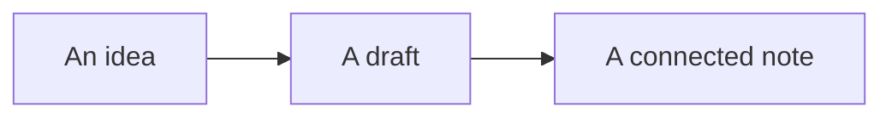

# Diagrams and drawings

Mermaid is plain text that becomes a diagram. Choose **Edit diagram** to edit its source with a live preview.



## A sequence

```mermaid
sequenceDiagram
  participant You
  participant Note
  You->>Note: Capture an idea
  Note-->>You: Find a connection
  You->>Note: Refine the thought
```

## A drawing you can edit here

Choose **Edit inline** to change the canvas without leaving this note. Drawing changes save to Sketch.excalidraw automatically.

![[Sketch.excalidraw|700]]

Open the drawing in its own tab using **Open drawing**. Use the command palette to create more drawings or insert another Mermaid diagram.
